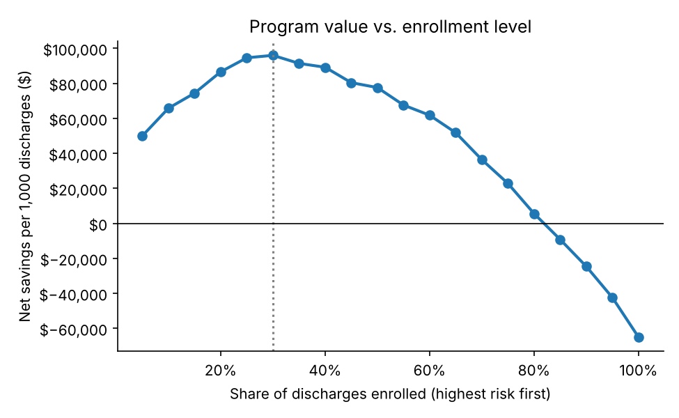
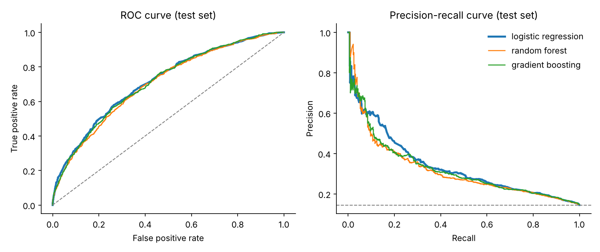
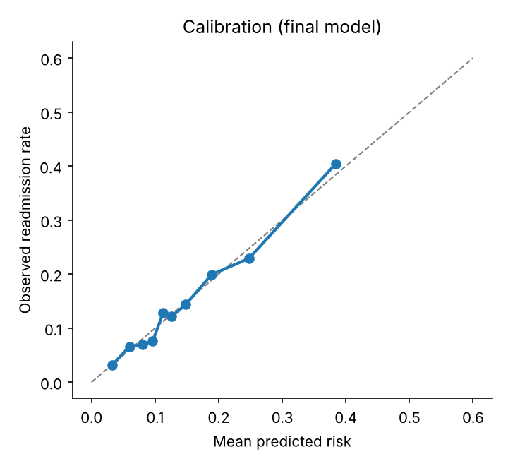
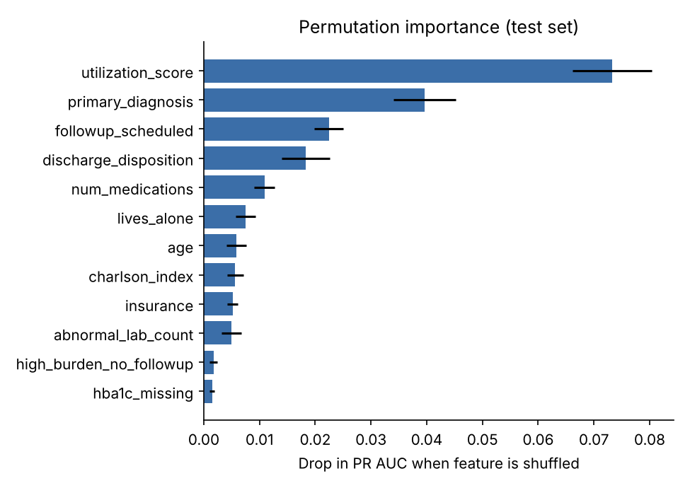
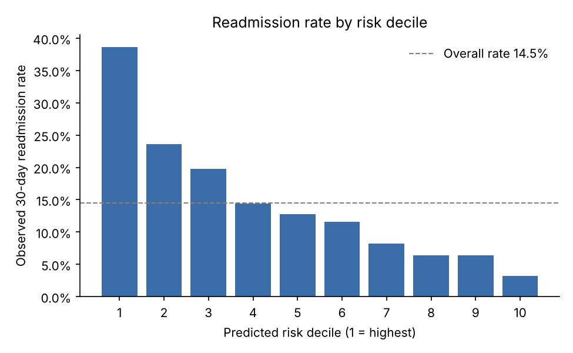

# Hospital Readmission Risk: Targeting Transitional Care Where It Pays Off

Predicting which patients are likely to be readmitted within 30 days of discharge, and turning that prediction into a decision: **who should get a follow-up program, and how many patients can a hospital afford to enroll?**

  

> **Data note:** every record in this project is synthetic, produced by [`data/generate_data.py`](data/generate_data.py). The generator encodes clinically plausible relationships (prior utilization, comorbidity burden, discharge disposition, follow-up care) so the modeling behaves like a real readmission problem. No real patient data is used.

---

## The business problem

Under the CMS Hospital Readmissions Reduction Program, hospitals with excess readmissions lose a share of Medicare payments, and every readmission is also a costly, avoidable event for the patient. Transitional care programs (a nurse call within 48 hours, a medication review, an early clinic visit) reduce readmissions, but they cost money per patient and care-management staff time is limited.

So the real question isn't only "can we predict readmission?" It's this:

**Which patients should we enroll so the program prevents the most readmissions for the money?**

## Results at a glance

| | |
|---|---|
| **Final model** | Logistic regression with engineered utilization features, isotonic calibration |
| **Test ROC AUC** | 0.715 (published readmission models typically land between 0.65 and 0.75) |
| **Test PR AUC** | 0.337, 2.3× the 14.5% base rate |
| **Top-decile lift** | 2.7×: 38.6% of the highest-risk 10% are readmitted, vs. 14.5% overall |
| **Top 20% of patients** | Account for 43% of all readmissions |
| **Recommended enrollment** | Top **30%** by predicted risk, about **$96,000 net savings per 1,000 discharges** |
| **Enrolling everyone** | **Loses** about $65,000 per 1,000 discharges under the same assumptions |

The last two rows carry the main message. Under these cost assumptions, the program loses money when applied to everyone and makes money when it's targeted. The model is what makes it profitable.



## Approach

### 1. Data
25,000 synthetic inpatient discharges with demographics, primary diagnosis, length of stay, Charlson comorbidity index, prior admissions and ED visits, medication count, lab abnormalities, HbA1c, discharge disposition, payer, social factors (lives alone) and whether a follow-up appointment was scheduled. HbA1c is missing for 35% of patients and living situation for 8%, as in real records.

### 2. Feature engineering
Features are clinically motivated and kept simple enough to explain to a care-management team:

- **`utilization_score`**: log-scaled prior admissions plus ED visits. This is consistently the strongest readmission signal in the literature, and it's the strongest here too.
- **`los_extreme`**: flags very short (≤1.5 days) and very long (≥12 days) stays, since risk is U-shaped in length of stay.
- **`high_burden_no_followup`**: high comorbidity burden *and* no follow-up scheduled, the gap a transitional care program is designed to close.
- **`hba1c_missing`**: whether the lab was drawn at all carries information.

### 3. Model selection
Three model families were compared with 5-fold stratified cross-validation on the training set (80% split), ranked on PR AUC because the positive class is the minority and the decision is about the top of the ranking:

| Model | CV ROC AUC | CV PR AUC | CV Brier |
|---|---|---|---|
| **Logistic regression** | **0.703 ± 0.011** | **0.305** | **0.115** |
| Gradient boosting (HistGradientBoosting) | 0.692 ± 0.009 | 0.290 | 0.116 |
| Random forest | 0.687 ± 0.011 | 0.286 | 0.116 |

**The simplest model won.** With well-designed features, logistic regression matched or beat the tree ensembles. For a clinical tool, that's the result you want, because every coefficient can be explained to a physician and audited. The selected model was then recalibrated with isotonic regression so predicted risks can be read as real probabilities.



### 4. Calibration
A risk score that says "30%" should mean roughly 30% of those patients come back. Care managers use the number directly, so calibration matters as much as ranking.



### 5. What drives risk
Permutation importance on the held-out test set (the drop in PR AUC when each feature is shuffled):



Recent utilization dominates, followed by diagnosis, whether follow-up was scheduled, and discharge disposition. Follow-up scheduling and disposition are things the hospital can change, which makes them natural levers for the program.

### 6. Subgroup checks
Before recommending a model that decides who gets extra care, it should be checked across groups ([full table](reports/tables/subgroup_performance.csv)):

- **ROC AUC holds between 0.68 and 0.73** across age bands, sex and payer.
- **Calibration is within ±1.5 percentage points** for every group except self-pay patients (n=186), where the model over-predicts by about 4 points. That group is small, so I'd flag it for monitoring rather than act on it now. In a real deployment it's a candidate for group-specific recalibration.

### 7. From prediction to decision
The program economics are parameterized in [`InterventionAssumptions`](src/readmission/evaluate.py):

| Assumption | Value |
|---|---|
| Program cost per enrolled patient | $500 |
| Average cost of a readmission | $15,000 |
| Share of readmissions the program prevents | 20% |

For each enrollment level (top 5%, 10%, … 100% by risk), the pipeline computes readmissions prevented, program cost and net savings ([table](reports/tables/intervention_value.csv)). Net savings peak at about **30% enrollment**. The curve is fairly flat between 25% and 40%, so the hospital can choose a point in that range based on care-manager capacity without giving up much value.



These assumptions are illustrative. The point of building the analysis this way is that a hospital can plug in its own costs and measured program effectiveness and get its own answer.

## Repository structure

```
├── data/
│   └── generate_data.py        # synthetic discharge generator (seeded, reproducible)
├── src/readmission/
│   ├── features.py             # feature engineering + preprocessing pipeline
│   ├── evaluate.py             # metrics, lift, subgroup checks, program economics
│   ├── pipeline.py             # end-to-end train / select / calibrate / report
│   └── predict.py              # score new discharges into risk tiers
├── reports/
│   ├── metrics.json
│   ├── figures/                # all charts in this README
│   └── tables/                 # model comparison, lift, subgroups, economics
├── tests/                      # unit tests (reproducibility, leakage, metric math)
├── Makefile
└── requirements.txt
```

## Run it yourself

```bash
git clone https://github.com/chatnic/hospital-readmission-prediction.git
cd hospital-readmission-prediction
python -m venv .venv && source .venv/bin/activate
make setup      # install dependencies
make all        # generate data -> train -> evaluate -> test  (~1 minute)
```

Score new discharges with the trained model:

```bash
PYTHONPATH=src python -m readmission.predict --input new_discharges.csv --output scored.csv
```

Each patient gets a calibrated `readmission_risk` and a `risk_tier` (low / medium / high).

## What I'd do next in a real engagement

- **Use a temporal split**, training on earlier discharges and testing on later ones, to measure performance the way it will actually be used.
- **Add EHR-derived signals** such as vitals at discharge, polypharmacy interactions, and social determinants from case-management notes (NLP).
- **Measure the program, not just the model.** Run a randomized rollout or a stepped-wedge design so the 20% risk-reduction assumption becomes a measured number.
- **Monitor** calibration drift and subgroup performance monthly, and recalibrate when needed.

## License

MIT. See [LICENSE](LICENSE).
